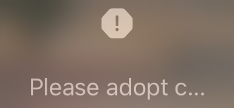
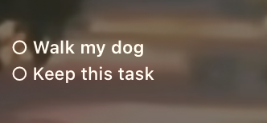
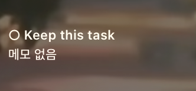

# 삭제·날짜 수정 — iPad 실기기 최종 검증

## 후속 수정: 잠금화면 표시 권한 복구 (12:59 KST)

사용자가 잠금화면 표시를 사용할 수 없다고 보고했다. 앞선 QA에서 원래 꺼져 있던 실시간 현황 권한을 꺼짐으로 복원했고, 앱은 이 상태를 기기 미지원과 같은 `사용할 수 없어요` 제목으로 표시하며 시작 버튼을 비활성화했다.

- 권한 꺼짐은 `잠금화면 표시를 위해 설정에서 허용해 주세요`로 구분하고, 활성화된 `설정` 버튼으로 앱의 시스템 설정을 연다.
- 연결된 같은 iPad의 기존 사용자 데이터로 설정 이동 → 실시간 현황 켜기 → 시작 → `LIVE` 확인 → 정상 재실행 후 `LIVE` 유지까지 검증했다. 단일 후속 실기기 테스트 1개 통과, 실패 0개(25.562초).
- **이번에는 사용자 요청에 따라 실시간 현황 권한을 켜고 활동을 시작한 상태로 유지했다.** QA 데이터 초기화·주입 없이 기존 카드로 실행했다.
- 결과: `/Users/nam/.codex/tmp/locktodonote-review-ipad-20261028/permission-recovery-retry.xcresult`.

아래는 이 후속 수정 이전의 10개 회귀 테스트 기록이며, 설정 복원에 관한 설명도 당시 상태를 가리킨다.

---

2026-10-28 KST. **연결된 iPad Air 11인치(M2), iPadOS 26.6.2에서 최종 UI 테스트 10개가 모두 통과했다.** 실패·스킵은 0개다. 앱·Widget/Share Extension·UI 테스트 러너의 기기용 Debug 빌드와 서명도 성공했다.

공유 패키지는 **142개 통과**. 수정 전 소스에서도 실패한 테스트 정의 2개(파라미터별 합계 assertion 3건)는 이전과 동일하게 제외했다. 전체 단위 테스트가 전부 녹색이라는 뜻은 아니다.

## 실제 UI 검증

| 시나리오 | 최종 결과 |
|---|---|
| Apple Reminders QA 목록 가져오기·완료 원본 반영 | 통과 |
| 캘린더 탐색 시 자동 모드 유지, 명시적 고정·재실행 유지·자동 복귀 | 통과 |
| 편집 화면에서 일반 항목 삭제 후 닫기·다른 항목 보존 | 통과 |
| 전체 반복 삭제 확인창·규칙 제거·재실행 유지 | 통과 |
| 앞으로 반복 중단·실행 중 날짜 경계·다음 날·모레 재실행 | 통과 |
| 오늘만 삭제·같은 날 재실행·다음 날 반복 복귀·일반 삭제 유지 | 통과 |
| 무료 모드에서 반복 중단·자동 날짜 변경·다음 주(11월 4일) 재실행 후 재생성 없음 | 통과 |
| 실제 홈 화면 위젯의 삭제 전후 표시 | 통과 |
| Live Activity를 종료한 상태의 실제 잠금화면 accessory 위젯 | 통과 — 렌더링 픽셀과 OCR로 확인, OS 지연 후 재실행 경계 포함 |
| 실제 잠금화면 Live Activity의 삭제 반영 | 통과 |

날짜는 DEBUG 앱 시계로 주입했다. iPad 운영체제 날짜는 변경하지 않았다. 앱 재실행과 실행 중 날짜 전환을 검증했으며 실제 자정을 장시간 기다린 시험은 아니다. Dynamic Island는 이 iPad의 지원 대상이 아니므로 앞선 iPhone 시뮬레이터 결과와 구분한다.

## 실기기에서 추가 발견·수정한 문제

**잠금화면 위젯의 배경 API 누락.** 실제 위젯은 할 일 대신 `Please adopt c...` 경고를 표시했다. 홈 위젯에만 `containerBackground`가 적용되어 있었고 accessory 분기에는 빠져 있었다. iOS 17 이상 accessory 분기에 투명한 제거 가능 배경을 추가했다. 기존 홈 위젯의 배경과 위젯 종류, iOS 16 호환 분기는 유지했다. [Apple의 위젯 배경 지침](https://developer.apple.com/documentation/widgetkit/displaying-the-right-widget-background).

**중복 갱신 요청과 지연 관측.** 공유 저장 이후 같은 스냅샷의 반복 게시에서도 여러 번 갱신을 요청하고 있었다. 실제 타임라인 진단에서 삭제 뒤 최신 상태로 요청은 나갔지만 OS의 새 타임라인 콜백이 늦는 구간을 확인했다. 저장을 동기화한 뒤 요청하고, 시각만 바뀐 중복 게시는 합쳤다. 카드 파일·예약/프로필 파일의 변경, 날짜 고정 모드·표시 설정·권한 만료·시간대·앱 버전/프로세스는 별도로 비교해 필요한 갱신을 생략하지 않는다. 동일 상태도 나중에 다시 요청할 수 있게 해, 요청을 OS의 갱신 완료로 간주하지 않는다.

데이터가 바뀌거나 재요청이 필요했던 경우 앱의 백그라운드 전환 시 마지막 갱신을 한 번 더 요청한다. 전경 요청도 제한될 수 있고 데이터가 바뀌면 백그라운드 전환 시 마지막 요청을 권장한다는 [Apple WWDC26 지침](https://developer.apple.com/videos/play/wwdc2026/277/)을 따랐다. 추가 갱신 타이머나 반복 백그라운드 깨우기는 만들지 않았다.

**즉시 갱신 보장은 하지 않는다.** 최종 accessory 위젯 시험도 처음에는 이전 프레임이 남았다. 삭제 상태를 초기화하지 않은 실제 앱 강제 종료·재실행 경계를 거친 후, 새 타임라인이 `Keep this task`만 읽고 실제 위젯에서도 `Walk my dog`가 사라진 것을 확인했다. 최종 로그에 이 경로를 명시했다. iOS의 다음 갱신 시점을 앱이 강제로 보장한다는 뜻은 아니다. [WidgetKit 갱신 정책](https://developer.apple.com/documentation/widgetkit/keeping-a-widget-up-to-date).

## 실제 화면 증거

테스트는 Live Activity를 종료한 상태에서 accessory 위젯을 따로 검증했다. OS가 위젯 내부 글자를 독립적인 텍스트 요소로 노출하지 않아, 실제 위젯 버튼 영역을 캡처하고 기기 내 Vision OCR로 읽었다. 캡처 이미지도 확인했다.

- 삭제 전: `O Walk my dog O Keep this task`
- 삭제 후: `O Keep this task`
- 저장소: 삭제한 항목 없음, 반복 중단 상태 재실행 후 유지

## 기존 데이터·설정 복원

테스트 전 카드 JSON·App Group 설정·레이아웃과 앱 환경설정을 Mac의 비공개 폴더에 별도 백업했다. 각 실기기 테스트 뒤 원래 데이터를 복원하고 QA 인수 없이 앱을 재실행했다. 최종 실행 종료 후 기기에서 다시 읽어 다음을 확인했다.

- 원래 카드 **5개** 보존
- 카드 제목·본문·종류·개인정보 설정·고정 상태 보존
- 항목 ID·내용·완료 상태·완료 시각/출처·반복 규칙/시리즈 ID 보존
- 저장된 레이아웃 파일 원본과 바이트 단위 동일
- QA 카드, QA 백업 파일, QA Reminders 기록 파일 없음
- QA Reminders 목록 정리
- 원래 꺼져 있던 Live Activity OS 설정은 검증 중에만 켰다가 다시 꺼짐으로 복원(`0 → 1 → 0`)

기본 앱의 정상 미완료 이월로 날짜·수정 시각은 바뀔 수 있다. 테스트 중 사용자가 추가한 잠금화면 위젯은 유지했다. 사용자 카드 원문·설정 화면·기타 알림 내용은 보고서용 증거에 복사하지 않았다.

## 이번 후속 작업의 변경 파일

| 파일 | 내용 |
|---|---|
| `Extensions/WidgetExtension/GlanceCardLockScreenWidget.swift` | accessory 배경 API, DEBUG 한정 타임라인 진단 |
| `Packages/LockTodoNoteShared/.../AppGroup/AppGroupStore.swift` | 공유 저장 동기화, 중복 갱신 비교·재시도·최종 백그라운드 갱신 |
| `LockTodoNote/App/LockTodoNoteApp.swift` | 백그라운드 전환 시 보류된 위젯 갱신 전송 |
| `LockTodoNote/Core/Testing/DeviceQASupport.swift` | DEBUG 한정 진단·테스트 제어 |
| `Tests/LockTodoNoteUITests/LockTodoNoteUITests.swift` | 실기기 10개 시나리오, 실제 픽셀 검증, 테스트별 데이터·OS 설정 복원 |
| `Packages/LockTodoNoteShared/Tests/.../AppGroupQueueTests.swift` | 동일 게시 억제, 삭제·모드/미래 입력 변경·지연 재시도 회귀 테스트 |

광고 ID·미디에이션·Firebase·결제 정책·Smart Repeat 권한·기존 위젯 종류는 변경하지 않았다. 출시용 권한 우회는 추가하지 않았다.

## 결과 파일과 남은 범위

[최종 실기기 결과](review-fix-qa-2026-10-28/ipad/final-results.json), [실제 UI 실행 로그](review-fix-qa-2026-10-28/ipad/final-ui-tests.log), [복원 검증](review-fix-qa-2026-10-28/ipad/restore-verification.json), [공유 테스트 로그](review-fix-qa-2026-10-28/ipad/shared-tests.log).

원본 xcresult와 사용자 데이터 백업은 `/Users/nam/.codex/tmp/locktodonote-review-ipad-20261028`에 보관한다. 초기 실행의 미설치·비활성 설정·표시 오류·갱신 지연과 최종 통과 결과를 구분한다. 최종 결과 파일은 10개 전체 선택 실행에서 실패 0·스킵 0이다.

**요청한 연결 iPad 검증은 완료했다.** iPhone Dynamic Island 실기기, 실제 자정/시간대 변경을 오래 기다리는 시험, App Store 1.2.0과 로컬 소스의 배포 매핑은 별도 범위다. 기존 단위 테스트 실패 3개 assertion도 남아 있으므로 이번 실기기 통과만으로 출시 승인을 판정하지 않는다. 최초 수정 원인과 시뮬레이터 검증은 [원 보고서](review-fix-report-2026-10-28.md)를 참조한다.
