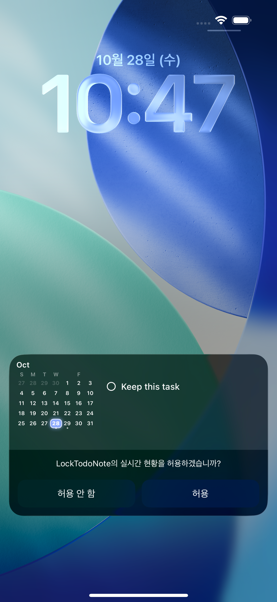
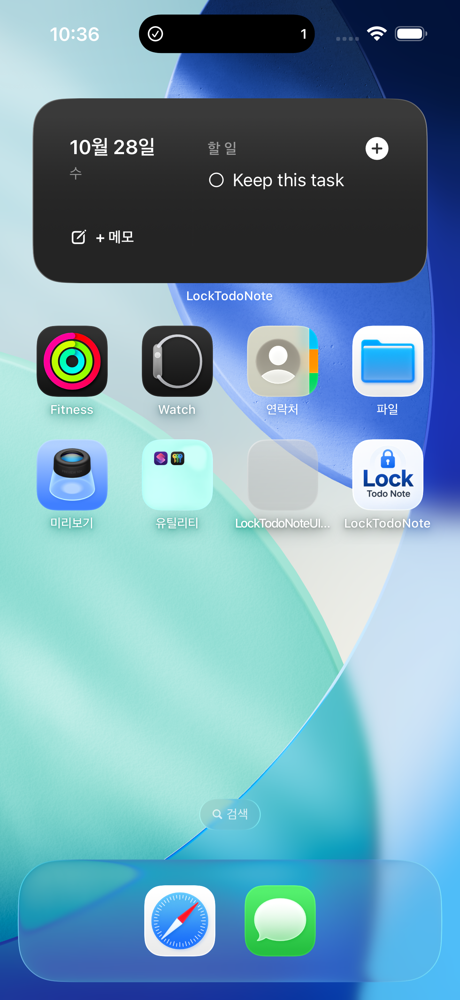
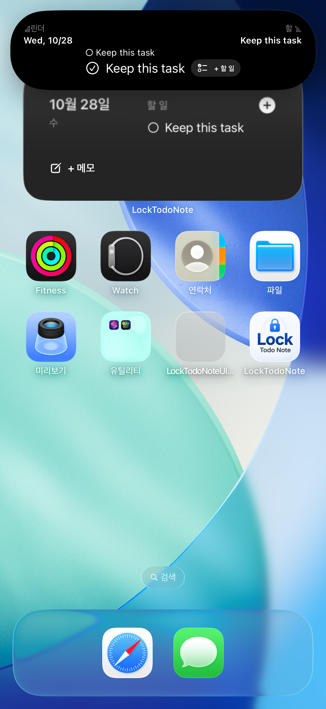

# 리뷰 기반 삭제·날짜 수정 검증 보고서

> 후속 iPad 실기기 최종 UI 테스트 10개가 모두 통과했다. 추가 위젯 수정과 복원 검증은 [실기기 보고서](review-fix-ipad-report-2026-10-28.md)에 기록했다. 아래 내용은 최초 시뮬레이터 검증 시점의 보고서다.

2026-10-28 KST. 기준 커밋: `23ce651`. **코드 수정과 시뮬레이터 핵심 검증은 완료했으나 출시 승인은 보류한다.** 연결된 iPhone이 없으며, 잠금화면 accessory 위젯의 실제 설치·표시와 실기기 장시간 날짜 경계 검증이 남아 있다.

## 1. 재현 및 원인

- 삭제 증상: 과거 완료된 반복 원본 → 오늘 발생분 생성 → 오늘 카드 ID만 삭제 → 내일 다시 생성되는 경로를 `oldCardOnlyDeletionReproducesReview`로 재현했다. 반복 원본이 전혀 남지 않은 첫 항목 삭제까지 항상 재생성되는 것은 아니다.
- `CardStore.delete(id:)`는 카드 한 개를 삭제하지만 `createRecurringTodosForToday`는 과거 같은 시리즈 항목을 계속 원본으로 사용했다. 날짜 제외·시리즈 종료 상태가 없어 발생분 삭제를 구분하지 못했다. `projectedTodos`의 별도 미래 투영도 과거 원본을 사용했다.
- 카드 ID 단위 삭제는 다중 항목 카드의 다른 할 일까지 함께 지웠다.
- 일반 항목에는 반복 생성 규칙이 없다. 미완료 이월도 이미 저장소에서 제거된 일반 항목을 자체적으로 되살리지는 않는다. 실제 UI 재실행·다음 날 테스트에서 일반 삭제가 유지되는 것을 확인했다.
- 날짜 증상: `CalendarTabView`의 날짜 선택이 `selectExplicitDate`를 호출했다. 설정 정규화는 이 연결을 강제로 켰다. 조회가 영구 고정으로 바뀌어 이후 오늘 자동 추적이 중단될 수 있었다. 수정 전 날짜 동작은 코드로 확인했고, 수정 후 분리·고정·복귀는 실제 UI에서 검증했다.
- Apple Reminders는 원본이 소유한 별도 미러이며 로컬 반복 규칙을 만들지 않는다. 기존 삭제 제한을 유지했다. 실 EventKit 서비스 경로의 가져오기·완료 원본 반영을 시뮬레이터에서 통과했다.
- Flutter 마이그레이션은 완료 버전으로 재실행을 막는다. 관련 기존 테스트가 통과했다. 이번 재생성 원인으로 확인되지 않았다.

## 2. 저장 및 삭제 정책

`CardMutations.deleteTodo`는 항목 ID와 `effectiveRecurrenceId`, 대상 날짜를 사용한다. 결과는 기존 `CardStore.commit` → `CardRepository.save`의 JSON 원자적 쓰기로 저장한다.

| 선택 | 영구 상태 및 처리 |
|---|---|
| 일반 항목 삭제 | 해당 항목 제거, 같은 카드의 다른 항목·무관한 카드 보존 |
| 이 날짜만 삭제 | 해당 날짜의 발생분 제거, `excludedDateKeys`에 날짜 기록 |
| 앞으로 반복 중단 | 해당 날짜 이상 발생분 제거, `recurrenceEndDateKey`를 배타적 종료 날짜로 저장, 이전 완료 기록 보존 |
| 전체 반복 삭제 | 같은 시리즈의 발생분·완료 기록·보존 규칙 제거, 과거 기록 삭제를 별도 확인창으로 안내 |

삭제된 발생분은 `checklistItems`에서 제거한다. 마지막 원본 삭제 시 필요한 반복 정의와 정책은 별도 `Card.recurrenceRules`에 보존한다. 화면에서만 숨기는 구현이 아니다. 과거 원본과 보존 규칙에 정책을 전파하고, 생성 시 제외 날짜의 합집합·가장 이른 종료 날짜를 병합한다. 이월 경로도 이 정책을 검사한다. 생성된 발생분은 원래 시리즈 ID를 유지한다.

새 Codable 필드는 예전 JSON에 없으면 빈 배열·빈 집합·nil로 읽는다. 기존 기록을 재작성하는 일괄 마이그레이션이나 데이터 초기화는 추가하지 않았다. 이전 바이너리로 다운그레이드하면 새 정책 필드를 이해하지 못하므로 다운그레이드 동작까지 보장하는 것은 아니다.

## 3. 날짜 및 표시 갱신

- 캘린더 탐색은 조회만 한다. 별도 ‘이 날짜를 잠금화면에 고정’과 ‘오늘 자동 표시’ 버튼을 제공한다.
- 기존 `followToday = false`와 저장 날짜를 보존한다. Today 탭 진입으로 명시적 고정을 해제하지 않는다. 고정 상태와 자동 표시 복귀 버튼을 Today 화면에 표시한다.
- 날짜 고정 시 날짜 자체도 즉시 공유 설정에 저장한다.
- 앱 복귀, 날짜 변경·유의미한 시간 변경 알림에서 다시 읽고 게시한다. 전경 타이머 및 백그라운드 갱신 예약은 Smart Lock Screen을 쓰지 않는 무료 사용자에게도 자정을 포함한다.
- 미래 dashboard 투영은 실제 이월·반복 엔진을 재사용한다. Smart Lock Screen 필터도 보존 규칙을 유지한다.
- 저장 후 기존 App Group 게시·WidgetKit 타임라인 갱신·ActivityKit 업데이트 경로를 유지한다.
- Live Activity 자동 모드의 stale 시점을 자정과 기존 8시간 기준 중 빠른 시점으로 설정했다. iOS가 백그라운드 실행, 즉시 위젯 갱신, 종료된 Live Activity 재시작을 보장하지 않는다. 앱 실행 없이 무기한 표시되거나 정확히 자정에 항상 ActivityKit 갱신된다고 주장하지 않는다.

## 4. 변경 파일과 주요 함수

| 파일 | 주요 변경 |
|---|---|
| `Packages/LockTodoNoteShared/.../Models/ChecklistItem.swift` | 제외 날짜·반복 종료 날짜 Codable, `isRecurrenceDue` |
| `Packages/LockTodoNoteShared/.../Models/Card.swift` | 별도 `recurrenceRules` 보존 및 하위 호환 디코딩 |
| `Packages/LockTodoNoteShared/.../Models/CardMutations.swift` | `deleteTodo`, `rollOverIncompleteTodos`, `createRecurringTodosForToday` |
| `Packages/LockTodoNoteShared/.../Dashboard/DashboardComposer.swift` | `projectedTodos` 엔진 통합 |
| `Packages/LockTodoNoteShared/.../Dashboard/SmartLockScreenSchedule.swift` | `filteredCards` 규칙 보존 |
| `Packages/LockTodoNoteShared/.../Dashboard/LockScreenSettings.swift` | 조회·날짜 고정 연결 기본값 분리 |
| `LockTodoNote/Core/Storage/CardStore.swift` | 항목 단위 `deleteTodo`, 규칙 편집 전파, 주입 가능한 시계 |
| `LockTodoNote/Core/LiveActivity/DashboardCoordinator.swift` | 시계 주입, 고정 날짜 저장, `refreshForDateBoundary` |
| `LockTodoNote/Core/LiveActivity/LiveActivityService.swift` | `staleDate` 자정 반영 |
| `LockTodoNote/Core/Automation/SmartLockScreenService.swift` | 무료 사용자 포함 자정 갱신 예약 |
| `LockTodoNote/Features/Home/LockScreenTabView.swift` | 항목 단위 삭제, 고정 표시·자동 복귀 |
| `LockTodoNote/Features/Todo/QuickAddSheet.swift` | 공통 `TodoDeletionModifier`, 편집 삭제 후 닫기 |
| `LockTodoNote/Features/Calendar/CalendarTabView.swift` | 조회와 명시적 고정 분리 |
| `LockTodoNote/App/AppShellView.swift`, `RootView.swift`, `AppEnvironment.swift` | 의도한 고정 유지, 날짜 알림, 시계 연결 |
| `LockTodoNote/Core/Testing/DeviceQASupport.swift` | DEBUG 전용 QA 시계·시드·날짜 전환 |
| 공유 테스트 2개 파일, `Tests/LockTodoNoteUITests/LockTodoNoteUITests.swift` | 삭제·투영·실제 UI 회귀 테스트 |

`CardRepository`, 광고 ID·미디에이션·Firebase·결제 정책·Pro 권한·위젯 종류는 변경하지 않았다.

## 5. 실행 환경과 결과

새로 만든 격리 환경: **LockTodoNote Review Fix QA / iPhone 17 Pro Max / iOS 26.1** (`091CDD1E-C47F-45FE-8EBE-101705FC4F8C`). 기존 사용자 기기와 기존 시뮬레이터 데이터는 초기화하지 않았다. 날짜는 DEBUG 앱 시계 주입으로 이동했으며 운영체제 날짜를 변경하지 않았다.

- `xcodebuild build-for-testing`: 최종 성공. 앱·공유 모듈·위젯/공유 확장·테스트 빌드 포함. Release archive/배포 서명 빌드를 실행한 것은 아니다.
- 공유 테스트: 최종 **138개 통과**. 기존 실패 테스트 정의 2개(파라미터별 합계 3개 assertion 실패)를 명시적으로 제외했다. 무수정 기준 커밋을 별도 임시 디렉터리에 복원한 132개 테스트에서도 같은 3개 실패를 재현했다.
- 기존 실패: `mixedTemplatesFollowTheSelectedInputTab`의 calendarItems·memoTodo 두 경우, `quickCaptureServiceParsesBulletsAndCleansMemo`의 줄 끝 공백 기대값. 이번 삭제·날짜 변경과 무관한 함수이며 요청 범위 밖이라 수정하지 않았다. 전체 테스트가 모두 녹색이라고 판정하지 않는다.
- 새 삭제 회귀 7개 및 dashboard 미래 투영 1개 통과. 매일·평일·주간·격주·지정 요일·N일 간격, JSON 재읽기, 과거 완료 기록, 미래 미리보기, 무관한 카드 보존을 검증했다. 기존 Smart Quick Add/고급 반복·마이그레이션 테스트도 제외한 기존 실패 외에는 통과했다.
- 실제 UI 테스트: 주요 6개 **전부 통과**, 최종 편집 삭제 경로 1개 **통과**. 총 7개. Live Activity UI 테스트의 첫 실행은 화면 반영 전 접근성 레이블을 읽어 실패했으며, 저장 상태와 비동기 화면 갱신을 기다린 후 재검증해 통과했다.
- 실제 홈 위젯: 시스템 홈 화면에 설치하고 두 항목 표시 → 앱에서 앞으로 반복 중단 → 다른 한 항목만 남음까지 수동 확인했다.
- 실제 Live Activity: 시스템 잠금화면에서 다른 항목만 남음을 XCTest와 스크린샷으로 확인했다.
- Dynamic Island: 축소 카운트가 2 → 1로 바뀌고, 확장 화면에 `Keep this task`만 표시됨을 수동 확인했다.
- App Group: 삭제 후 `cards.json`에서 `Walk my dog` 발생분이 제거되고 보존 규칙에 `recurrenceEndDateKey = 2026-10-28`이 저장됨을 확인했다.

| 요구 시나리오 | 검증 |
|---|---|
| 1 일반 삭제 | 실제 UI + 재실행/다음 날 + 공유 테스트 통과 |
| 2 오늘만 삭제 | 실제 UI + 같은 날 재실행 + 다음 날 발생 통과 |
| 3 앞으로 중단 | 실제 UI + 29·30일 재실행, 공유 테스트 내일·모레·다음 주·30일 후 통과 |
| 4 전체 시리즈 삭제 | 실제 UI 확인창·재실행 + 과거 기록 제거 공유 테스트 통과 |
| 5 강제 종료·재실행 | 실제 UI 통과 |
| 6 다음 날 | 주입 시계 실제 UI 및 공유 테스트 통과 |
| 7 다중 항목 중 하나 삭제 | 실제 UI에서 다른 항목 보존 통과 |
| 8 캘린더 조회 | 자동 모드 유지 실제 UI 통과 |
| 9 날짜 경계 | 실행 중 QA 시계 전환 후 날짜·데이터 갱신 통과; 실제 자정 장시간 대기는 미실행 |
| 10 명시적 고정 | 탭 이동·다음 날 재실행에도 유지 실제 UI 통과 |
| 11 자동 복귀 | 버튼 전환·재실행·다음 날 실제 UI 통과 |
| 12 위젯·Live Activity | 홈 위젯·Live Activity·Dynamic Island 실제 시뮬레이터 확인; accessory 잠금화면 위젯 실제 표시 미검증 |
| 13 기존 데이터 | 구 JSON·Flutter 마이그레이션 자동 테스트 통과; 기존 실기기 설치본 업데이트 검증 미실행 |
| 14 Reminders | 시뮬레이터 EventKit QA 목록 가져오기·완료 원본 반영 통과; 실기기 iCloud 동기화 미검증 |

## 6. App Store 및 출시 판단

확인 시점 공개 버전은 **1.2.0**, Apple lookup의 출시 시각은 `2026-10-27T19:48:10Z` (**2026-10-28 04:48:10 KST**)이다. 로컬 `project.yml`은 **1.1.8 / build 18**이다. [App Store 버전 기록](https://apps.apple.com/sr/app/locktodonote-lock-screen-todo/id6783183501?platform=vision), [Apple lookup](https://itunes.apple.com/lookup?id=6783183501&country=us).

따라서 현재 공개 배포본과 이 소스의 동일성을 단정할 수 없다. 10월 27일 리뷰 작성자의 설치 버전, 당시 배포 바이너리와 소스 매핑, 현재 1.2.0에서의 재현 여부는 확인되지 않았다. 스토어 리뷰 원문만으로 해당 사용자의 반복 설정이나 설치 버전을 확정하지 않았다.

연결된 실제 iPhone이 없어 **iPhone 실기기 테스트는 수행하지 않았다**. 발견된 연결 기기는 iPad Air(M2)였으며 이번 테스트는 격리된 iPhone 시뮬레이터에서 수행했다.

**출시 보류**: iPhone에서 accessory 잠금화면 위젯 설치·삭제·날짜 경계, 앱을 닫은 상태의 자정/시간대 변경, 실제 이전 배포본 업그레이드 및 iCloud Reminders 동기화, App Store 1.2.0 소스 매핑, 기존 테스트 실패의 출시 영향 확인이 남아 있다. 첨부 요구사항의 ‘실기기 포함 최종 합격’으로 보고하지 않는다.

## 7. 증거

[검증 파일과 스크린샷](review-fix-qa-2026-10-28/). `ui-results.json`(6개), `editor-results.json`(1개), 각 테스트 로그, 기준 커밋 테스트 로그, App Store 조회, 실제 삭제 후 App Group JSON을 포함한다.

